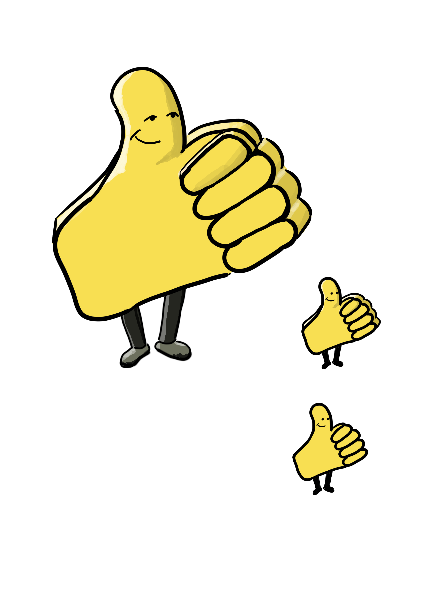

# Das stumme Maskottchen

## Funktion
Ein wiederkehrendes, gelbes, daumenförmiges Wesen mit freundlichem Gesicht. Es ist **kein eigenständiger Akteur**, sondern ein austauschbares Systemartefakt und ein grafisches Signal für passive Bestätigung, positiven Bias und Echo-Kammern.

## Visuelle Varianten
- **Große Figur:** Daumenförmiger Körper mit Gesicht, Beinen und Füßen.
- **Kleine Figur:** Kompakte Darstellung mit reduziertem Detailgrad.
- **Flache Logoversion:** Stark vereinfachtes Symbol für kleine grafische Anwendungen.

Alle drei Darstellungen gehören zum selben Maskottchenkonzept und sind keine verschiedenen Figuren.

## Verbindliche Regeln
Siehe [RULES.md](../../RULES.md), insbesondere Abschnitt 5, und [LORE-GUARD.md](../../LORE-GUARD.md), insbesondere Abschnitt 4.

Das Maskottchen spricht nicht, initiiert keine Handlung, löst keine Probleme und widerspricht nicht. Es bestätigt nur passiv. Es ist weder Held noch Antagonist und selbst nicht die Pointe.

## Verwendung
Das Maskottchen kann als Motiv auf Aushängen, Schildern und Verwaltungskommunikation erscheinen. **Der Text eines Schilds ist nicht automatisch eine Aussage des Maskottchens.**

### Bisherige Auftritte
- [Strip 001 – Woke durch den nuklearen Winter](../../strips/001%20-%20Woke%20durch%20den%20nuklearen%20Winter/README.md): Aushänge in der Kantine.
- [Strip 003 – Be Prepared](../../strips/003%20-%20Be%20Prepared/README.md): Umzugshinweis im zweiten Panel.

## Status
Visuelle Referenz nach bereitgestelltem Charaktersheet. Weitere Posen oder neue aktive Eigenschaften sind nicht kanonisiert.
