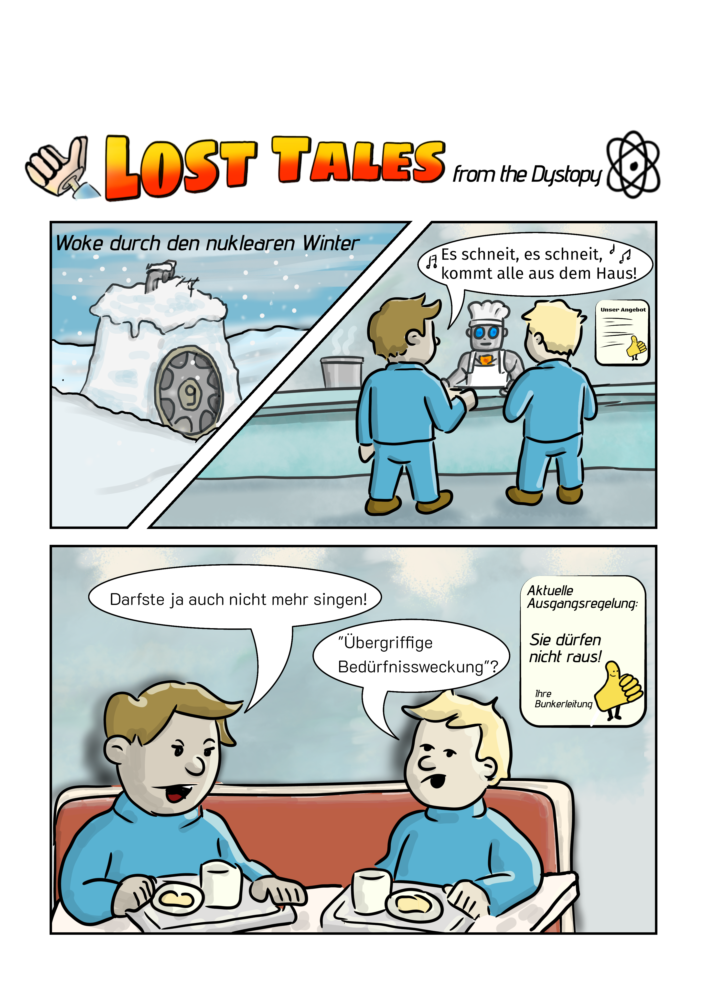

# Strip 001 – Woke durch den nuklearen Winter

## Titel
Woke durch den nuklearen Winter

## Layout
Drei erzählerische Bildabschnitte: oben links Außenansicht, oben rechts Kantine, unten ein breites Schlussbild. Die oberen Abschnitte sind diagonal getrennt.

## Ort
Verschneiter Zugang zu **Bunker 9**; Kantine im Bunker. Die frühere Ortsangabe „Block 31“ wurde bewusst verworfen, da der ursprüngliche Entwurf und die Zeichnungen zu stark an bestehende Fallout-Lore angelehnt waren. Die fertig gezeichnete Fassung mit Bunker 9 ist maßgeblich.

## Figuren
Zwei Bunkerbewohner in blauen Overalls; Kantinenpersonal im Hintergrund.

## Maskottchen
Vorhanden, **als grafisches Motiv auf Aushängen** der Bunkerverwaltung. Es spricht nicht und handelt nicht.

## Thema
- Regelgläubigkeit und Verwaltungslogik
- Wutbürger-Rhetorik und politisierte Schuldzuschreibung
- Moralische Aufladung alltäglicher Handlungen
- Widerspruch zwischen Regeln und Lebenswirklichkeit

## Kurzbeschreibung
### Bildabschnitt 1 – Außen
Ein Bunkerzugang mit der Nummer 9 ist unter Schnee begraben. Der Titel lautet „Woke durch den nuklearen Winter“.

### Bildabschnitt 2 – Kantine
Zwei Bewohner stehen am Tresen. Einer singt „Es schneit, es schneit, kommt alle aus dem Haus!“. Ein Aushang mit Maskottchen ist im Hintergrund zu sehen.

### Bildabschnitt 3 – Schlussbild
Die Bewohner sitzen beim Essen. Einer behauptet, man dürfe nicht mehr singen; der andere antwortet mit „Übergriffige Bedürfnisweckung“?. Rechts hängt ein Aushang: „Aktuelle Ausgangsregelung: Sie dürfen nicht raus! Ihre Bunkerleitung“ mit dem Maskottchen.

## Pointe
Die rhetorische Empörung über ein vermeintliches Singverbot trifft auf ein tatsächliches, administrativ formuliertes Ausgangsverbot. Die absurde Regelwirklichkeit wird nicht durch eine Lösung aufgelöst.

## Anmerkungen
- Dokumentiert nach der vorliegenden fertig kolorierten Fassung.
- Der zuvor dokumentierte Dialog „Danke Merkel“ erscheint in dieser Bildfassung **nicht** und ist daher nicht Bestandteil der aktuellen Dialogtranskription.
- **Kanon:** Bunker 9 ersetzt Block 31. Frühere Zeichnungen und die alte Ortsangabe sind verworfene Entwurfsstände und keine Referenz für neue Arbeiten.
