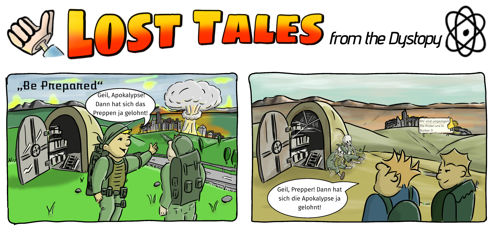

# Strip 003 – Be Prepared

## Titel
„Be Prepared“

## Layout
Zwei nebeneinander angeordnete breite Panels; starker visueller Zeitsprung bei ähnlichem Bildaufbau.

## Ort
Oberfläche vor einem Bunkereingang; im Hintergrund eine Stadt. Konkrete Bunkernummer im Bild nicht festgelegt.

## Figuren
Zwei Personen mit Ausrüstung im ersten Panel; zwei Überlebende bzw. Passanten im zweiten Panel. Ob es sich um dieselben Figuren handelt, ist aus dem Bild nicht verbindlich festgelegt.

## Maskottchen
Vorhanden, als grafisches Motiv auf dem Hinweisschild im zweiten Panel; passiv, ohne eigene Handlung oder Sprache.

## Thema
- Prepper-Mentalität und Selbstbestätigung
- Der Widerspruch zwischen erwarteter und erlebter Katastrophe
- Banalität und Vergänglichkeit nach der Apokalypse
- Systemische Routine selbst nach dem Zusammenbruch

## Kurzbeschreibung
### Panel 1
Vor einem offenen Bunker stehen zwei ausgerüstete Personen. In der Ferne steigt über der Stadt ein Atompilz auf. Eine Person kommentiert begeistert: „Geil, Apokalypse! Dann hat sich das Preppen ja gelohnt!“

### Panel 2
Dieselbe Landschaft erscheint verwüstet und gealtert. Am Bunkereingang sind Spinnweben und Skelette zu sehen. In der Ferne steht ein Hinweisschild, dass die Bunkerbewohner umgezogen seien und nun in Bunker 9 zu finden seien. Zwei Personen im Vordergrund wiederholen sinngemäß die frühere Aussage.

## Pointe
Die triumphale Selbstbestätigung aus dem ersten Panel wird im zweiten angesichts des sichtbaren Verfalls absurd. Der Satz wird wiederholt, während das Bild zeigt, wie wenig dauerhaft oder sinnvoll die ursprüngliche Vorbereitung war.

## Anmerkungen
- Dokumentation nach der vorliegenden fertig kolorierten Fassung.
- Das Schild im zweiten Panel ist Teil der Welt und kein Sprechakt des Maskottchens.
- Eine genaue Chronologie oder Identität der beiden Personengruppen wird nicht behauptet.
